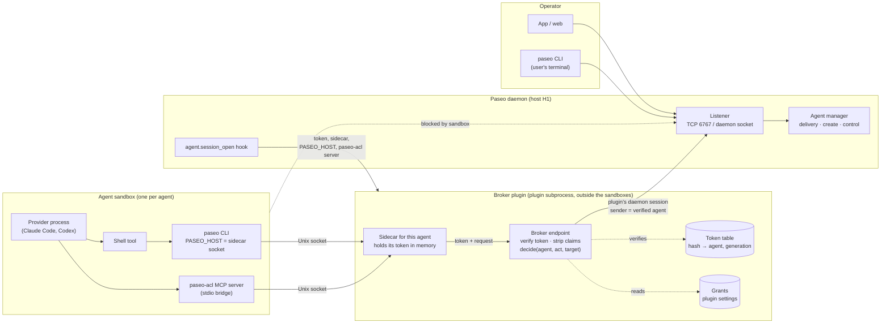

# Agent identity and grants for Paseo, as a broker plugin

Status: ideation draft for the task `agent-broker-plugin` (`index.md` beside this file), 2026-11-19. Target: a Paseo plugin first, with optional core changes proposed upstream to `getpaseo/paseo` later.

## Purpose

Today an agent names itself when it calls Paseo. The CLI sends `PASEO_AGENT_ID` from the agent's environment, and the agent tool endpoint `/mcp/agents` reads `callerAgentId` from its URL. The daemon checks neither. Any agent can direct any other agent while it claims a third agent's name, on the local daemon and through a connected host. The recipient records the claimed name as the sender.

This design puts a broker between the agents and the daemon:
- **Identity:** the broker issues a token for each agent launch. A sidecar holds the token and adds it to the agent's requests. The agent never holds the token.
- **Grants:** the user decides, with explicit grants, what an agent may do beyond itself. The broker enforces them before it forwards a request to the daemon.

The first change a user can see: the "Sent by" name on an agent message is true. The first access control a user can see: "P may send to B" is allowed, and every other agent is refused, even one that claims to be P or claims no name.

## Requirements

The broker holds only when all of these are true:
1. **The sandbox isolates each agent:**
   - The agent can connect to its own sidecar socket and to no other.
   - It cannot read the sidecar's memory, environment or files.
   - It cannot reach the daemon's listener (the TCP port or the daemon socket).
   - It cannot read or write `$PASEO_HOME`, which includes `local-credential` and `config.json`.
2. **The daemon runs with `daemon.mcp.injectIntoAgents: false`.** This removes the built-in `paseo` tools, which trust `callerAgentId`.
3. **The broker plugin is enabled.**

If any of these is missing, an agent can reach the daemon some other way and act with the operator's authority. `SECURITY.md` already states this for processes of the daemon's user. The plugin's documentation lists these requirements.

## Architecture



- **Operator path:** the app and your CLI use the daemon listener with the password or the local credential, as today.
- **Agent path:**
  1. The agent's CLI and its `paseo-acl` MCP server connect to the agent's sidecar.
  2. The sidecar adds the token.
  3. The broker endpoint verifies the token, applies the grants, and forwards the request to the daemon over the plugin's own session, with the verified agent as sender.
- **Launch:** at `agent.session_open`, the plugin creates the token, starts the sidecar, sets `PASEO_HOST`, and adds the `paseo-acl` server.
- **The sandbox** allows the agent only its own sidecar socket.

## Design

### Token and sidecar

- At each `agent.session_open`, the plugin creates a random token for that agent and launch. It keeps the hash, mapped to the agent ID and a launch generation.
- The plugin starts a sidecar for the agent. The sidecar receives the token on standard input, never in its environment or arguments, keeps it only in memory, and listens on a Unix socket in a runtime directory outside `$PASEO_HOME`. The path is short, because macOS limits a socket path to 104 bytes.
- The plugin returns, in the session-open request:
  - `env.PASEO_HOST` set to the sidecar socket, so that the agent's CLI connects to it;
  - an MCP server, `paseo-acl`: a stdio bridge to the sidecar. Its tools match the built-in ones (`send_agent_prompt`, `create_agent`, `list_agents`, `get_agent_status`, …).

  It uses an MCP server rather than attached plugin tools. Paseo serves attached tools through `/mcp/agents` and keys them by `callerAgentId` (`agent/tools/plugin-tools.ts:18`), which is exactly the claim the broker must not trust.
- The sidecar adds the token to each request, replaces any credential the agent sent, and makes no decisions.

### Broker endpoint

- **Verify:** it resolves the token to `agent:<id>`. An unknown, revoked or old-generation token is refused.
- **Strip claims:** it ignores `PASEO_AGENT_ID`, `callerAgentId` and `sourceAgentId` from the agent, and refuses a claim that disagrees with the token.
- **Decide:** it runs `decide(agent, act, target)` against the grants. It denies by default and does not read prompt text. Each denial has one reason code:
  - `unknown_token`;
  - `identity_mismatch`;
  - `no_grant`;
  - `host_not_granted`;
  - `policy_unavailable`.

  Each decision is one JSON line, with the digest of the grants that decided it.
- **Forward:** it sends each allowed request over the plugin's daemon session (`context.paseo`). It sets the sender (`sourceAgentId`) and, on a create, the caller (`callerAgentId`) to the verified agent. The daemon records these as the sender and the parent. It trusts them because, under the requirements, only the operator and the plugin can open daemon sessions.
- **CLI protocol:** the endpoint carries the WebSocket messages that agents' CLI commands need (`send`, `run`, `ls`, `logs`, `wait`), and refuses every other message type.

### Grants

The grants are host-scoped plugin settings (`defineSettings`), edited on the plugin's settings screen:

```json
[
  { "subject": "agent:P", "act": "send",   "target": "agent:B" },
  { "subject": "agent:P", "act": "direct", "target": "started-by:self" }
]
```

- **Acts:**
  - `send`: a prompt or a message;
  - `read`: status, activity, logs and timelines;
  - `control`: cancel, stop and archive;
  - `create`;
  - `direct`: all of these.
- **Subjects and targets:** agent IDs, and the relation `started-by:self`. An orchestrator gets one grant, `direct` on `started-by:self`, instead of one grant for each child.
- **Without a grant**, an agent may act only on itself, for reads as well as writes.

### Parentage

- The parent labels drive the app's subagents track, finish notifications to the parent, parent and child behavior on archive, and the `started-by:self` grant.
- On a create, the broker passes the verified caller, and the daemon stamps `paseo.parent-agent-id` and `paseo.parent-server-id` from it.
- The broker strips `paseo.parent-*` from every label write that an agent sends. Agents have no other route to the daemon, so the labels stay correct.

### Connected hosts

**First release:** the broker refuses every agent request that names another host.

**Second release: explicit grants on both sides.**
- On the origin, a grant with `"host": "srv_H2"` lets agent P act on that host. The origin forwards `agent:P@srv_H1` across the link, never the token.
- On the destination, that host's user grants the remote subject, for example `{ "subject": "agent:P@srv_H1", "act": "send", "target": "agent:R" }`. A child that P creates there gets the parent `P@srv_H1`, so `started-by:self` works there too.
- The destination accepts an `@srv_H1` subject only from the authenticated link of `srv_H1`. An address is valid only on the link to the host it names.

## Where state lives

| Data | Where | After a restart |
|---|---|---|
| Grants | The plugin's host-scoped settings | Kept |
| Parentage | Agent record `agents/{dir}/{agentId}.json`, stamped by the daemon from the broker's verified caller | Kept |
| Decisions | The plugin's audit log, one JSON line each | Kept |
| Token hashes, agent ID, generation | The plugin's memory | Gone. Agents get new tokens when their sessions reopen. |
| The token itself | The sidecar's memory only | Gone with the sidecar |

Nothing secret is written to disk, and nothing secret enters the agent's sandbox.

## Lifecycle

- **Session open (create, resume, refresh, import):** a new token, a new generation and a new sidecar. The old token is revoked and the old sidecar stops.
- **Agent close or archive:** the plugin observes `agent.closed` or `agent.archived`, revokes the token and stops the sidecar.
- **Plugin reload, disable or crash:** the sidecars and the endpoint stop, so agents lose Paseo access until their sessions reopen. With `injectIntoAgents: false`, agents then have no Paseo tools at all. That fails closed.
- **Daemon restart:** the plugin restarts with it. Agents resume with new tokens, as with any session open.

## Changes

| Area | Where | Change |
|---|---|---|
| Broker plugin | New plugin package (prototype: `acl-broker-plugin/` on branch `acl/broker-plugin` of `clkao/paseo`) | Session-open hook, token table, sidecars, broker endpoint, `paseo-acl` MCP server, grants settings, audit log |
| Daemon config | `config.json` | `daemon.mcp.injectIntoAgents: false` |
| Sandbox | Safehouse profile, or the container setup | Allow each agent only its own sidecar socket path, which must be predictable from the agent ID. Deny the daemon listener and `$PASEO_HOME`. |
| Paseo core | none required | See "Optional core changes" |

### Optional core changes

These go upstream only when the plugin shows the need:
1. **Built-in tool injection per agent.** Today `injectIntoAgents` is daemon-wide. A per-agent switch would let unbrokered agents keep the built-in tools.
2. **An `agent.request` policy hook,** called with a caller that the core has resolved, before any side effect. It would bring in-process tools (OpenCode's bridge, native catalogs) under the same grants. Those tools bypass the broker today.
3. **Agent tokens in daemon admission.** This would make "Sent by" true even for a daemon session that an agent opens directly, without relying on the sandbox to keep agents away from the listener.

## Open questions

The prototype answers these:
1. Can `agent.session_open` set `PASEO_HOST`?
2. Can the plugin's daemon session set `sourceAgentId` and `callerAgentId`, so that the daemon records the right sender and parent?
3. What does `injectIntoAgents: false` remove? Voice mode's `speak` tool is expected to go, so the plugin would have to provide and forward it.
4. Does Codex's own sandbox block the sidecar socket? Which setting allows it?
5. Which CLI messages must the endpoint carry?
6. One sidecar per agent, or one sidecar process for all agents: memory cost.

## Alternatives considered

- **Identity in the daemon core:** agent tokens in admission, a policy hook, daemon-owned parent labels. It also covers in-process tools and holds without the sandbox keeping agents off the listener. But it changes the protocol and needs upstream agreement before anyone can use it. The plugin works on today's plugin system, and the core can take over later through the optional changes above.
- **The OS reports the caller's process.** The daemon reads the peer process ID and walks the parent chain to the agent's launch. It needs no secret. It was not chosen:
  - process IDs are reused, and the check races against process exit;
  - a double-forked process escapes it;
  - it needs native code for each platform;
  - it is not a credential that is issued, verified and audited.
- **A token in the agent's environment or in a private file.** The agent holds the token, so the token can leak into a transcript, a log or another agent's prompt, and be replayed.
- **Plugin-attached tools instead of an MCP server.** Paseo serves them through `/mcp/agents`, keyed by the forgeable `callerAgentId`.
- **An inherited socketpair (fd 3).** Neither Claude Code nor Codex passes an inherited descriptor to its tools or MCP servers.
- **A broker with one OS user for each agent.** Users do not create OS accounts for each agent.
- **An immutable scope envelope for each agent, narrowed at each delegation** (as in shisad's task envelopes). While the user is the only writer of grants and a child starts with none, there is nothing to narrow.

## Evidence

- Forged identity accepted on the CLI, on `/mcp/agents` and through a connected host: `.spacedock/repo/research/forged-caller-identity/`.
- Broker with one OS user for each agent: `.spacedock/repo/research/os-user-broker/`.
- Channel probe on macOS in Safehouse and on Linux: `.spacedock/repo/research/agent-channel-probe/`, with the Linux logs on the VM in `~/acl-result/channel-probe/`. It shows three things:
  - a stdio MCP server started by Claude Code or Codex can reach a named Unix socket;
  - an inherited descriptor does not reach the tools;
  - Safehouse allows connecting only to listed socket paths.
- Review of an earlier, core-based version of this design: `.spacedock/repo/notes/agent-identity-envelope-review.md`.
- Background:
  - `.spacedock/repo/notes/agent-access-capability-pattern.md`: exe.dev integrations, Macaroons, Zanzibar, Tailscale;
  - `.spacedock/repo/notes/keycard-lessons.md`: Keycard's egress-proxy.
