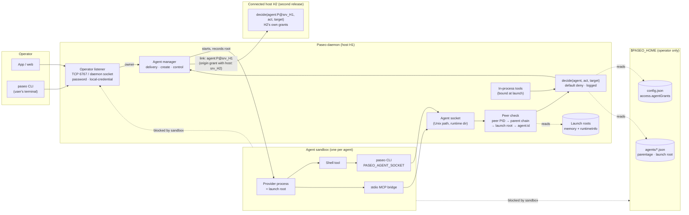

# Agent identity and grants in the Paseo daemon

Status: design proposal, 2026-11-19. Target: an upstream pull request to `getpaseo/paseo`.

## Purpose

Today an agent names itself when it calls Paseo. The CLI sends `PASEO_AGENT_ID` from the agent's environment, and the agent tool endpoint `/mcp/agents` reads `callerAgentId` from its URL. The daemon checks neither. Any agent can direct any other agent while it claims a third agent's name, on the local daemon and through a connected host. The recipient records the claimed name as the sender.

This design makes the daemon the authority:
- The daemon knows which agent is calling from the connection itself, with no secret.
- The user decides, with explicit grants, what an agent may do beyond itself.

The first change a user can see: the "Sent by" name on an agent message is true. The first access control a user can see: "P may send to B" is allowed, and every other agent is refused, even one that claims to be P or claims no name.

## Requirements for true isolation

The daemon identifies agents correctly in every setup. An agent is isolated from other agents and from the operator only when its sandbox also enforces all three of these:
1. The agent cannot reach the daemon's operator listener (the TCP port or the daemon socket).
2. The agent cannot read or write `$PASEO_HOME`, which includes `local-credential` and `config.json`.
3. The agent can connect to the agent socket.

Without such a sandbox, an agent that deliberately uses the operator listener gets operator authority, as `SECURITY.md` already states for processes of the daemon's user. Paseo still issues identities in that case, and the docs say what is missing.

## Architecture



- **Operator path:** the app and your CLI use the operator listener with the password or the local credential, as today, and get owner authority.
- **Agent path:** the agent's CLI and its Paseo tools use the agent socket. The peer check turns the connection into `agent:<id>`, and `decide` applies grants and parentage before the agent manager acts.
- **In-process tools** skip the socket. The daemon binds them to the agent at launch.
- **The sandbox** blocks the operator listener and `$PASEO_HOME`, and allows the agent socket.
- **Connected hosts:** the origin sends only the resolved address `agent:P@srv_H1`. The destination applies its own grants.

## Design

### Agent channel and identity

- The daemon listens on one **agent socket**, a Unix socket separate from the operator listener. It serves the same WebSocket protocol and the agent tool endpoint. The path is in a runtime directory outside `$PASEO_HOME`, and it is short: macOS limits a socket path to 104 bytes.
- At each launch of an agent's provider process, the daemon records the **launch root**: the process ID and start time of that process, with the agent ID and a launch generation.
- For each connection to the agent socket, the daemon reads the peer's process ID from the OS:
  - macOS: `LOCAL_PEERPID`, then `proc_pidinfo` for the parent and the start time;
  - Linux: `SO_PEERCRED`, then `/proc/<pid>/stat`.

  The daemon walks the parent chain until it reaches a recorded launch root. The connection becomes `agent:<id>` for that launch. A peer that reaches no launch root is refused. The agents' process trees do not overlap, because the daemon, not the parent agent, starts each agent.
- The agent learns the socket path from `PASEO_AGENT_SOCKET`. The path is not a secret. A copied path does not help another process, because the peer check still runs.
- The CLI connects to `PASEO_AGENT_SOCKET` when it is set. Paseo tools reach the agent socket through a stdio MCP server that the provider starts: the existing bridge `packages/server/scripts/mcp-stdio-socket-bridge-cli.mjs`. That replaces the HTTP URL with `?callerAgentId=` and the shared bearer.
- Tools that run inside the daemon get their agent from the launch context that the daemon created for them. The OpenCode bridge token is one for each agent, not one for each daemon.
- On the agent socket, the daemon ignores `callerAgentId`, `sourceAgentId` and `PASEO_AGENT_ID`. A claim that disagrees with the resolved agent is refused.

### Grants

The user writes grants in the daemon config, `$PASEO_HOME/config.json`:

```json
"access": {
  "agentGrants": [
    { "subject": "agent:P", "act": "send",   "target": "agent:B" },
    { "subject": "agent:P", "act": "direct", "target": "started-by:self" }
  ]
}
```

- **Acts:**
  - `send`: a prompt or a message;
  - `read`: status, activity and logs;
  - `control`: cancel, stop and archive;
  - `create`;
  - `direct`: all of these.
- **Subjects and targets:** agent IDs, and the relation `started-by:self`. An orchestrator gets one grant, `direct` on `started-by:self`, instead of one grant for each child.
- **Without a grant**, an agent may act only on itself.
- **Editing:** the user edits the file and reloads, or patches it through the existing daemon-config request. A change applies to the next request. Changing grants requires `access.manage`. Agent sessions never get `access.manage` or `daemon.manage`.

### Parentage

- The daemon writes `paseo.parent-agent-id` and `paseo.parent-server-id` on a new agent from the resolved caller.
- Callers cannot set or change those two labels through `create_agent`, `update_agent`, session create or session import. All other `paseo.*` labels stay as they are; the app's open-tab markers use them.
- The user can still detach an agent, which clears its parent.

### Decision point

One function in the daemon, `decide(agent, act, target)`, runs before any side effect, for every request from the agent socket and from in-process tools.
- It reads the resolved agent, the act, the target, parentage and the current grants. It does not read prompt text.
- It denies by default and writes each decision to the daemon log.
- The existing per-session operation permissions still apply. Agent sessions are admitted only to the operations that `decide` covers.

### Connected hosts

**First release:** the origin daemon refuses every operation that an agent routes to another host, before it opens a route. This refuses the forged-caller case through a connected host.

**Second release: explicit grants on both sides.**
- On the origin, a grant with `"host": "srv_H2"` lets agent P act on that host. The origin sends P's resolved address `agent:P@srv_H1` across the link, never a credential.
- On the destination, that host's user grants the remote subject, for example `{ "subject": "agent:P@srv_H1", "act": "send", "target": "agent:R" }`. A child that P creates there gets the parent `P@srv_H1`, so `started-by:self` works there too.
- The destination accepts an `@srv_H1` subject only from the authenticated link of `srv_H1`. A compromised origin can misuse only the grants given to its own agents.

## Plugin support

### What today's plugin system can and cannot do

A plugin could act as a broker: it opens its own socket, checks peers and forwards requests with its `context.paseo` session. The plugin API leaves out what that needs:

1. **No launch root.** No hook or event reports the provider's process ID. `agent.session_open` runs before the process exists, and `agent.created` carries no process ID. Without the launch root, the peer check has nothing to match.
2. **The built-in tools cannot be replaced for each agent.** `agent.session_open` can add MCP servers, but a name that collides with Paseo's internal `paseo` server fails the open. Only the daemon-wide `daemon.mcp.injectIntoAgents` turns the built-in tools off (`public-docs/plugins/reference.md`, "Inject MCP servers").
3. **The CLI path needs a full protocol proxy.** To catch an agent's `paseo` CLI, the plugin must carry the whole WebSocket protocol through its socket. The broker prototype allowed only two message types and broke most CLI commands.
4. **In-process tools never cross a plugin.** The OpenCode bridge and native tool catalogs run inside the daemon.
5. **The daemon cannot tell who the sender is.** The plugin forwards with owner authority and names the sender in a request field. The daemon cannot tell that assertion from any other owner's claim.
6. **Parentage is open.** Callers can write the parent labels through `create_agent` and `update_agent`. A plugin cannot reserve them.

So the system cannot carry the design as it is.

### Proposed split: identity in core, policy in a plugin

Identity must hold for every agent request, and it needs a native addon. It belongs in the core. Policy decides who may do what, which differs between users. It fits a plugin.

| Core (always on) | Policy plugin |
|---|---|
| Agent socket and peer check, launch roots | Grants and their storage |
| The resolved agent on every agent request, in-process tools included | `decide(agent, act, target)` |
| Daemon-owned parent labels | The editor for grants: a settings screen with host-scoped persisted values (`defineSettings`) |
| One call to the policy hook before each side effect | Audit records, if wanted |
| Origin-side refusal of agent routes to other hosts while no policy allows them | Host grants, both sides |

### New hook

```ts
server.before("agent.request", ({ request }) => {
  // request.caller: { agentId, serverId, parentAgentId }   resolved by the core, never claimed
  // request.act:    "send" | "read" | "control" | "create"
  // request.target: { kind: "agent" | "workspace" | "host" | "tool", id, serverId }
  // request.operation: the RPC or tool name
  // return undefined to allow; throw to refuse with a message
});
```

- **When it runs:** the core calls the hook for each request from an agent, after it has resolved the agent and before any side effect. It never calls the hook for operator requests.
- **Several policy plugins:** every registered plugin must allow the request. A throw, invalid data or the 30-second timeout refuses it, like the existing before hooks.
- **Connected hosts:** the destination calls its own hook with `caller.serverId` set to the origin. `started-by:self` uses `caller` and the target's parent, which `PluginHookAgent.parentAgentId` already carries.
- **Optional events:** `agent.runtime_started` and `agent.runtime_closed`, with the launch generation, for audit.

### Packaging the grants

The grants in this design can ship as a **built-in plugin** (`plugins/<id>/`, listed in `packages/server/src/server/plugins/builtin/index.ts`).
- Built-ins run in the daemon process, so the hook costs no inter-process round trip.
- Built-ins stay active independently of `pluginsEnabled`.
- Agent sessions must not reach plugin settings RPCs. The core admits agents only to the operations that the policy hook covers.

**With no policy plugin**, the core still resolves every agent, so the "Sent by" names are true. Requests are allowed as today. Installing or enabling the policy plugin makes grants explicit.

### What it takes

- **Core:**
  - the identity work in "Changes by package";
  - one hook name in the lifecycle registry;
  - the request schema in `@getpaseo/plugin/server`;
  - the call site at the decision point;
  - reference docs.
- **Plugin:** the grant parser, `decide`, the settings screen, and its tests. This is the policy code of this design moved behind the hook, not new behavior.

## Where state lives

| Data | Where | After a daemon restart |
|---|---|---|
| Grants | `config.json` → `access.agentGrants` | Kept |
| Parentage | Agent record `agents/{dir}/{agentId}.json`, labels written only by the daemon | Kept |
| Launch root (process ID, start time, generation) | Agent record, field `runtimeInfo` | Kept. Used to re-adopt or reject the agent |
| Connected-host link credentials | The connected-hosts store, as today | Kept |
| Decisions | `daemon.log` | Kept (log rotation) |
| Admitted agent sessions | Daemon memory, tied to the launch generation | Gone |
| Parsed grants | Daemon memory, reloaded when the config changes | Rebuilt |

No secret is issued, so none is stored.

## Lifecycle

- **Start and resume:**
  1. Each launch records a new launch root and increments the generation.
  2. The daemon sets `PASEO_AGENT_SOCKET` and configures the stdio MCP bridge in the launch context (`agent/agent-manager.ts`, `agent/runtime-mcp-config.ts`).
- **Agent process restart** (reload, idle cleanup, crash):
  - The daemon closes the sessions of the old generation.
  - A process that the old launch left behind no longer reaches a current launch root, so it is refused.
- **Daemon restart:**
  - On boot, the daemon reads each recorded launch root. A process that is still alive, with the same start time, is re-adopted; a missing or reused process ID is rejected.
  - Agents whose provider ended with the daemon resume later with a new launch root, as today.
  - Grants and parentage are on disk and do not change.
- **Archive:** closes the agent's sessions and clears its launch root. A process left behind is refused.
- **Escapes:**
  - A process that the agent starts with `setsid` or `nohup` stays a descendant and keeps the agent's identity.
  - A double-forked process is reparented to PID 1 and is refused.

## Changes by package

| Area | Files | Change |
|---|---|---|
| Agent socket | `bootstrap.ts`, `websocket-server.ts` | A second listener on a Unix path, for the WebSocket protocol and the agent tool endpoint. It admits only resolved agents. |
| Peer check | new module next to `authorization/` | Peer PID, parent chain and start time on macOS and Linux. This needs a small native addon, because Node's `net.Socket` does not expose peer credentials. The server already ships a native module (`node-pty`). |
| Launch | `agent/agent-manager.ts`, `agent/runtime-mcp-config.ts` | Record the launch root. Set `PASEO_AGENT_SOCKET`. Configure the stdio bridge in place of the HTTP tool endpoint. |
| In-process tools | `agent/tools/paseo-tools.ts`, `agent/providers/opencode/bridge.ts` | Bind the OpenCode bridge to one agent, including its context endpoint, which returns the agent's environment. |
| Decision | `authorization/`, call sites in `session.ts` and `paseo-tools.ts` | `decide()` and the grant parser. |
| Parentage | `paseo-tools.ts`, `agent/lifecycle-command.ts`, `agent/create-agent/`, `agent/import-sessions.ts` | Reserve the two parent labels. |
| Connected hosts | `agent/host-operations/index.ts` | First release: refuse agent routes at the origin. |
| CLI | `packages/cli/src/utils/client.ts`, `utils/caller-agent.ts` | Connect to `PASEO_AGENT_SOCKET` when it is set. Stop sending `PASEO_AGENT_ID` as identity. |
| Config | `persisted-config.ts`, `daemon-config-store.ts` | `access.agentGrants`, editable with `access.manage`. |
| Docs | `docs/permissions.md`, `SECURITY.md`, `docs/data-model.md`, `docs/connected-hosts.md` | Agent principals, grants, the requirements for isolation, and the agent socket. |

## Protocol compatibility

- **Identity:** the agent socket changes no message. Identity comes from the connection, not from a field, so old clients and old daemons are not affected.
- **New daemon, old CLI:** an old CLI in an agent's shell ignores `PASEO_AGENT_SOCKET` and uses the operator listener as before. A sandbox that meets the isolation requirements refuses that connection.
- **Feature gate:** the grant editing operations are new and are gated on `server_info.features`, per `docs/protocol-compatibility.md`.

## Open questions

1. **Claude Code's shell tool.** The Linux probe did not reach Claude's Bash tool, because the exe credits ran out. The stdio MCP path was verified under Claude.
2. **Windows.** Named pipes give the client process ID (`GetNamedPipeClientProcessId`). This was not tested.

## Alternatives considered

- **A secret credential for each agent,** in the agent's environment or a private file. It works with no native code. But a secret can leak into a transcript, a log or another agent's prompt, and anyone who reaches the daemon can replay it. The peer check has nothing to leak.
- **An inherited socketpair (fd 3).** Neither Claude Code nor Codex passes an inherited descriptor to its tools or MCP servers, so the channel never reaches the agent.
- **A broker process with one OS user for each agent.** It identifies agents by user ID, but users do not create OS accounts for each agent.
- **The peer check on the operator listener too,** so that an agent that bypasses the agent socket is still treated as an agent. On the default TCP port, every connection would need a lookup from connection to process: `/proc/net/tcp` and a file-descriptor scan on Linux, a scan of process file descriptors on macOS. That lookup is costly. The isolation requirements give one rule instead: agents use the agent socket, and the sandbox keeps them off the operator listener.
- **An immutable scope envelope for each agent, narrowed at each delegation** (as in shisad's task envelopes). While the user is the only writer of grants and a child starts with none, there is nothing to narrow. It becomes useful if agents may pass part of their grants to their children.

## Evidence

- Forged identity accepted on the CLI, on `/mcp/agents` and through a connected host: `.spacedock/dev/.spacedock-state/agent-identity-acl/`.
- Broker with one OS user for each agent: `.spacedock/dev/.spacedock-state/agent-identity-binding/`.
- Channel probe on macOS in Safehouse and on Linux (named socket with a peer check against an inherited socketpair, under Claude Code and Codex): `.spacedock/dev/.spacedock-state/agent-channel-probe/`. The Linux logs are on the VM in `~/acl-result/channel-probe/`.
- Independent review of the earlier version of this design: `.spacedock/repo/notes/agent-identity-envelope-review.md`.
- Background on the grant model: `.spacedock/repo/notes/agent-access-capability-pattern.md`.
