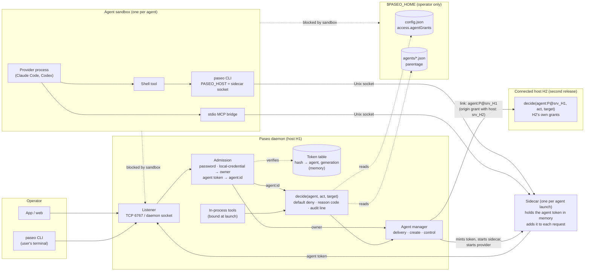

# Agent identity and grants in the Paseo daemon

Status: design proposal, 2026-11-19. Target: an upstream pull request to `getpaseo/paseo`.

## Purpose

Today an agent names itself when it calls Paseo. The CLI sends `PASEO_AGENT_ID` from the agent's environment, and the agent tool endpoint `/mcp/agents` reads `callerAgentId` from its URL. The daemon checks neither. Any agent can direct any other agent while it claims a third agent's name, on the local daemon and through a connected host. The recipient records the claimed name as the sender.

This design makes the daemon the authority:
- **Identity:** the daemon issues a token for each agent launch and verifies it on every request. A sidecar process holds the token and adds it to the agent's requests. The agent never holds the token.
- **Grants:** the user decides, with explicit grants, what an agent may do beyond itself.

The first change a user can see: the "Sent by" name on an agent message is true. The first access control a user can see: "P may send to B" is allowed, and every other agent is refused, even one that claims to be P or claims no name.

## Requirements for true isolation

The daemon identifies every agent whose requests carry a valid token. An agent is isolated from other agents and from the operator only when its sandbox also enforces all four of these:
1. The agent can connect to its own sidecar socket and to no other sidecar's socket.
2. The agent cannot read the sidecar's memory, environment or files.
3. The agent cannot reach the daemon's operator listener (the TCP port or the daemon socket).
4. The agent cannot read or write `$PASEO_HOME`, which includes `local-credential` and `config.json`.

Without such a sandbox, the agent still never holds its token, so the token cannot leak into its transcript. But a process of the same user can connect to another agent's sidecar, or use the operator listener with operator authority. `SECURITY.md` already states this for processes of the daemon's user. The docs list these four requirements.

## Architecture



- **Operator path:** the app and your CLI use the listener with the password or the local credential, as today, and get owner authority.
- **Agent path:** the agent's CLI and its stdio MCP bridge connect to the agent's sidecar. The sidecar adds the agent token and forwards to the daemon. Admission resolves the token to `agent:<id>`, and `decide` applies grants and parentage before the agent manager acts.
- **In-process tools** skip the sidecar. The daemon binds them to the agent at launch.
- **The sandbox** allows the agent only its own sidecar socket. It blocks the listener and `$PASEO_HOME`.
- **Connected hosts:** the origin sends only the resolved address `agent:P@srv_H1`, never the token. The destination applies its own grants.

## Design

### Agent token and sidecar

- **Minting:** at each launch of an agent's provider process, the daemon creates a random token. It keeps only its hash in memory, mapped to the agent ID and a launch generation.
- **The sidecar:** a small process that the daemon starts for each launch, outside the agent's sandbox.
  - It receives the token on its standard input, never in its environment or arguments, and keeps it only in memory.
  - It listens on a Unix socket in a runtime directory outside `$PASEO_HOME`. The path is short, because macOS limits a socket path to 104 bytes.
- **Wiring the agent:**
  - The daemon sets `PASEO_HOST` to the sidecar socket in the agent's launch environment, so the agent's CLI connects to the sidecar.
  - Paseo tools reach the sidecar through a stdio MCP bridge that the provider starts, in place of the HTTP URL with `?callerAgentId=`. The existing bridge `packages/server/scripts/mcp-stdio-socket-bridge-cli.mjs` is the starting point.
- **What the sidecar does:**
  - It writes the token into each request: the `auth` of the first WebSocket message, and the bearer of each tool-endpoint request.
  - It replaces any credential the agent sent, and it removes `callerAgentId`.
  - It makes no decisions. The daemon makes them all.
- **Admission:**
  - The daemon resolves a token to `agent:<id>` and admits that session only to the operations that `decide` covers.
  - It ignores `PASEO_AGENT_ID`, `callerAgentId` and `sourceAgentId`, and refuses a claim that disagrees with the token.
  - A request with an unknown, revoked or old-generation token is refused. It never falls back to owner.
- **In-process tools:** they get their agent from the launch context. The OpenCode bridge token becomes one per agent instead of one per daemon. Its context endpoint must stop returning the agent's environment to other callers.

### Grants

The user writes grants in the daemon config, `$PASEO_HOME/config.json`:

```json
"access": {
  "agentGrants": [
    { "subject": "agent:P", "act": "send",   "target": "agent:B" },
    { "subject": "agent:P", "act": "direct", "target": "started-by:self" }
  ]
}
```

- **Acts:**
  - `send`: a prompt or a message;
  - `read`: status, activity, logs and timelines;
  - `control`: cancel, stop and archive;
  - `create`;
  - `direct`: all of these.
- **Subjects and targets:** agent IDs, and the relation `started-by:self`. An orchestrator gets one grant, `direct` on `started-by:self`, instead of one grant for each child.
- **Without a grant**, an agent may act only on itself, for reads as well as writes.
- **Editing:** the user edits the file and reloads, or patches it through the existing daemon-config request. A change applies to the next request. Changing grants requires `access.manage`. Agent sessions never get `access.manage` or `daemon.manage`.

### Parentage

- The daemon writes `paseo.parent-agent-id` and `paseo.parent-server-id` on a new agent from the resolved caller.
- Callers cannot set or change those two labels through `create_agent`, `update_agent`, session create or session import. All other `paseo.*` labels stay as they are; the app's open-tab markers use them.
- The user can still detach an agent, which clears its parent.

### Decision point

One function in the daemon, `decide(agent, act, target)`, runs before any side effect, for every agent request: through a sidecar or from in-process tools.
- It reads the resolved agent, the act, the target, parentage and the current grants. It does not read prompt text.
- It denies by default. Each denial has one reason code:
  - `unknown_token`;
  - `identity_mismatch`;
  - `no_grant`;
  - `host_not_granted`;
  - `policy_unavailable`.
- It writes each decision as one JSON line to the daemon log, with the digest of the grants that decided it.
- The existing per-session operation permissions still apply.

### Connected hosts

**First release:** the origin daemon refuses every operation that an agent routes to another host, before it opens a route. This refuses the forged-caller case through a connected host.

**Second release: explicit grants on both sides.**
- On the origin, a grant with `"host": "srv_H2"` lets agent P act on that host. The origin sends P's resolved address `agent:P@srv_H1` across the link, never the token.
- On the destination, that host's user grants the remote subject, for example `{ "subject": "agent:P@srv_H1", "act": "send", "target": "agent:R" }`. A child that P creates there gets the parent `P@srv_H1`, so `started-by:self` works there too.
- The destination accepts an `@srv_H1` subject only from the authenticated link of `srv_H1`. An address is valid only on the link to the host it names. A compromised origin can misuse only the grants given to its own agents.

## Plugin support

### What today's plugin system cannot do

A plugin can already start a process and add environment variables and MCP servers at `agent.session_open`. The parts that make identity hold are missing:

1. **No agent credential to verify.** Admission knows only owner credentials. A plugin cannot add a token kind to admission, so a plugin's sidecar could forward only with owner authority. The daemon could not tell the sidecar's claim of a sender from any other owner's claim.
2. **The built-in tools cannot be replaced for each agent.** A plugin's MCP server named like Paseo's internal `paseo` server fails the open. Only the daemon-wide `daemon.mcp.injectIntoAgents` turns the built-in tools off (`public-docs/plugins/reference.md`, "Inject MCP servers").
3. **In-process tools never cross a plugin.** The OpenCode bridge and the native tool catalogs run inside the daemon.
4. **Parentage is open.** Callers can write the parent labels through `create_agent` and `update_agent`. A plugin cannot reserve them.

### Proposed split: identity in core, policy in a plugin

Identity must hold for every agent request, so it belongs in the core. Policy decides who may do what, which differs between users, so it fits a plugin.

| Core (always on) | Policy plugin |
|---|---|
| Tokens, sidecars and admission of agent tokens | Grants and their storage |
| The resolved agent on every agent request, in-process tools included | `decide(agent, act, target)` |
| Daemon-owned parent labels | The editor for grants: a settings screen with host-scoped persisted values (`defineSettings`) |
| One call to the policy hook before each side effect | Audit records |
| Origin-side refusal of agent routes to other hosts while no policy allows them | Host grants, both sides |

### New hook

```ts
server.before("agent.request", ({ request }) => {
  // request.caller: { agentId, serverId, parentAgentId }   resolved by the core from the token
  // request.act:    "send" | "read" | "control" | "create"
  // request.target: { kind: "agent" | "workspace" | "host" | "tool", id, serverId }
  // request.operation: the RPC or tool name
  // return undefined to allow; throw to refuse with a reason code
});
```

- **When it runs:** the core calls the hook for each agent request, after it has resolved the agent and before any side effect. It never calls the hook for operator requests.
- **Several policy plugins:** every registered plugin must allow the request. A throw, invalid data or the 30-second timeout refuses it, like the existing before hooks.
- **Connected hosts:** the destination calls its own hook with `caller.serverId` set to the origin.
- **Optional events:** `agent.runtime_started` and `agent.runtime_closed`, with the launch generation, for audit.

### Packaging the grants

The grants in this design can ship as a **built-in plugin** (`plugins/<id>/`, listed in `packages/server/src/server/plugins/builtin/index.ts`).
- Built-ins run in the daemon process, so the hook costs no inter-process round trip.
- Built-ins stay active independently of `pluginsEnabled`.

**With no policy plugin**, the core still resolves every agent, so the "Sent by" names are true. Requests are allowed as today. Enabling the policy plugin makes grants explicit.

## Where state lives

| Data | Where | After a daemon restart |
|---|---|---|
| Grants | `config.json` → `access.agentGrants`, or the policy plugin's settings | Kept |
| Parentage | Agent record `agents/{dir}/{agentId}.json`; the parent labels are written only by the daemon | Kept |
| Connected-host link credentials | The connected-hosts store, as today | Kept |
| Decisions | `daemon.log`, one JSON line each | Kept (log rotation) |
| Token hashes, agent ID, generation | Daemon memory | Gone |
| The token itself | The sidecar's memory only | Gone with the sidecar |
| Admitted agent sessions | Daemon memory, tied to the generation | Gone |

Nothing secret is written to disk, and nothing secret enters the agent's sandbox.

## Lifecycle

- **Start and resume:**
  1. The daemon mints a token and increments the generation.
  2. It starts the sidecar and passes the token on its standard input.
  3. It starts the provider, with `PASEO_HOST` set to the sidecar socket and the stdio MCP bridge configured (`agent/agent-manager.ts`, `agent/runtime-mcp-config.ts`).
- **Agent process restart** (reload, idle cleanup, crash): the daemon revokes the old token, closes the sessions of the old generation and stops the old sidecar. The new launch gets a new token and a new sidecar. A process that the old launch left behind reaches a stopped sidecar and gets nothing.
- **Daemon restart:**
  - Sidecars and providers are children of the daemon and end with it. The token table, which lived only in memory, is gone with it.
  - Agents resume later with new tokens and new sidecars, as today's resume does.
  - Grants and parentage are on disk and do not change.
- **Archive:** the daemon revokes the token, closes the agent's sessions and stops its sidecar.

## Changes by package

| Area | Files | Change |
|---|---|---|
| Sidecar | new entry next to `packages/server/scripts/mcp-stdio-socket-bridge-cli.mjs`, started through `managed-processes/` | Read the token from standard input, listen on the agent's socket, add the token, forward to the daemon. |
| Launch | `agent/agent-manager.ts`, `agent/runtime-mcp-config.ts` | Mint the token. Start the sidecar. Set `PASEO_HOST`. Configure the stdio bridge in place of the HTTP tool endpoint. |
| Admission | `session-admission-auth.ts`, `auth.ts`, `bootstrap.ts` (`/mcp/agents`) | Resolve agent tokens to `agent:<id>`. Stop trusting `callerAgentId`. Stop accepting the shared per-run tool token from agents. |
| Protocol | `packages/protocol/src/messages.ts` (hello `auth`), `packages/client` | New auth kind `agentToken`. Only the sidecar shipped with the same daemon sends it. |
| In-process tools | `agent/tools/paseo-tools.ts`, `agent/providers/opencode/bridge.ts` | Bind the OpenCode bridge and its context endpoint to one agent. |
| Decision | `authorization/`, call sites in `session.ts` and `paseo-tools.ts` | `decide()` or the policy hook, reason codes, the audit line. |
| Parentage | `paseo-tools.ts`, `agent/lifecycle-command.ts`, `agent/create-agent/`, `agent/import-sessions.ts` | Reserve the two parent labels. |
| Connected hosts | `agent/host-operations/index.ts` | First release: refuse agent routes at the origin. |
| CLI | `packages/cli/src/utils/caller-agent.ts`, `commands/agent/send.ts` | Stop sending `PASEO_AGENT_ID` as identity. The CLI already connects to a `unix://` `PASEO_HOST`. |
| Config, plugins | `persisted-config.ts`, plugin lifecycle registry, `@getpaseo/plugin/server` | `access.agentGrants`; the `agent.request` hook. |
| Docs | `docs/permissions.md`, `SECURITY.md`, `docs/data-model.md`, `docs/connected-hosts.md`, `docs/plugins.md` | Agent principals, tokens and sidecars, grants, the isolation requirements, the hook. |

## Protocol compatibility

- **The sidecar and the daemon ship together,** so the new `agentToken` auth kind never meets an old daemon.
- **The agent's own CLI** speaks the existing protocol to the sidecar, and the sidecar replaces the `auth` field. An old CLI in an agent's shell therefore works through the sidecar unchanged.
- **Grant editing** is a new operation and is gated on `server_info.features`, per `docs/protocol-compatibility.md`.

## Open questions

1. **Cost of one sidecar per running agent.** A Node process for each agent costs memory. One sidecar process that serves every agent's socket would cost less. It is still safe if each socket's token stays bound to that socket inside the process. Measure before choosing.
2. **The MCP leg.** The stdio bridge reaches the sidecar under Claude Code and Codex: the channel probe connected a stdio MCP server to a named Unix socket under both. The forwarding from the sidecar to `/mcp/agents` still has to be built and tested.
3. **Claude Code's shell tool.** The CLI path from Claude's Bash tool to a Unix socket has not been tested on Linux, because the exe credits ran out.
4. **Windows.** Named pipes in place of Unix sockets. This has not been tested.

## Alternatives considered

- **The OS reports the caller's process.** The daemon reads the peer process ID of each connection and walks the parent chain to the agent's launch. It needs no secret. It was not chosen:
  - process IDs are reused, and the check races against process exit;
  - a double-forked process escapes it;
  - it needs native code for each platform;
  - it ties identity to a process tree instead of a credential that the daemon issues, verifies and audits.
- **A token in the agent's environment or in a private file.** It is simpler, with no sidecar. But the agent holds the token, so the token can leak into a transcript, a log or another agent's prompt, and anyone who reaches the daemon can replay it.
- **One daemon-owned socket for each agent, with identity by which socket was used.** It needs no token. But identity would depend on socket paths and sandbox rules, with no credential that the daemon verifies on each request or that carries across a link.
- **An inherited socketpair (fd 3).** Neither Claude Code nor Codex passes an inherited descriptor to its tools or MCP servers, so the channel never reaches the agent.
- **A broker with one OS user for each agent.** It identifies agents by user ID, but users do not create OS accounts for each agent.
- **An immutable scope envelope for each agent, narrowed at each delegation** (as in shisad's task envelopes). While the user is the only writer of grants and a child starts with none, there is nothing to narrow. It becomes useful if agents may pass part of their grants to their children.

## Evidence

- Forged identity accepted on the CLI, on `/mcp/agents` and through a connected host: `.spacedock/dev/.spacedock-state/agent-identity-acl/`.
- Broker with one OS user for each agent: `.spacedock/dev/.spacedock-state/agent-identity-binding/`.
- Channel probe on macOS in Safehouse and on Linux: `.spacedock/dev/.spacedock-state/agent-channel-probe/`, with the Linux logs on the VM in `~/acl-result/channel-probe/`. It shows that a stdio MCP server started by Claude Code or Codex can reach a named Unix socket, that an inherited descriptor does not reach the tools, and that Safehouse allows connecting only to listed socket paths.
- Review of an earlier version of this design: `.spacedock/repo/notes/agent-identity-envelope-review.md`.
- Background: `.spacedock/repo/notes/agent-access-capability-pattern.md` (exe.dev integrations, Macaroons, Zanzibar, Tailscale), `.spacedock/repo/notes/keycard-lessons.md` (Keycard egress-proxy).
