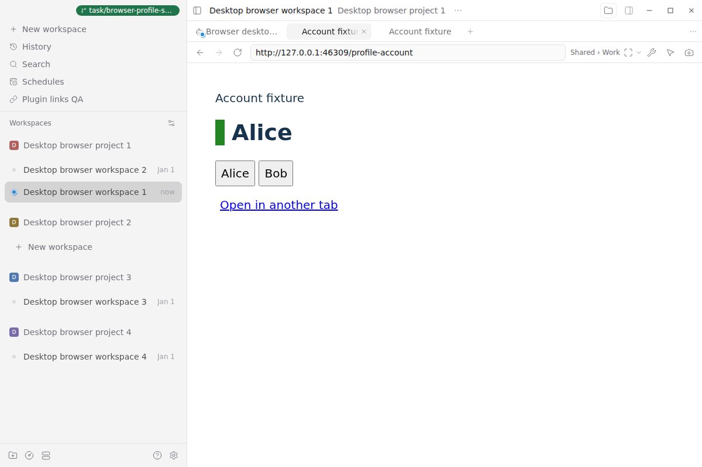
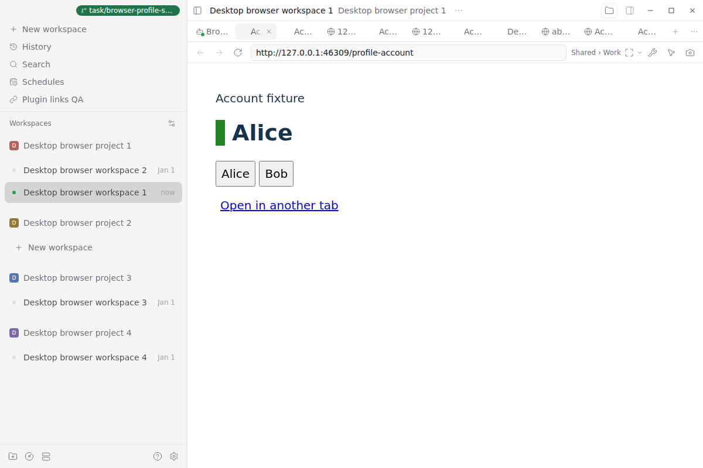
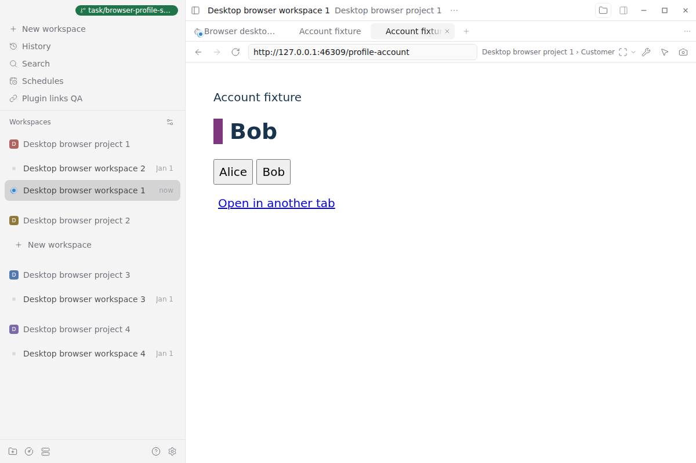
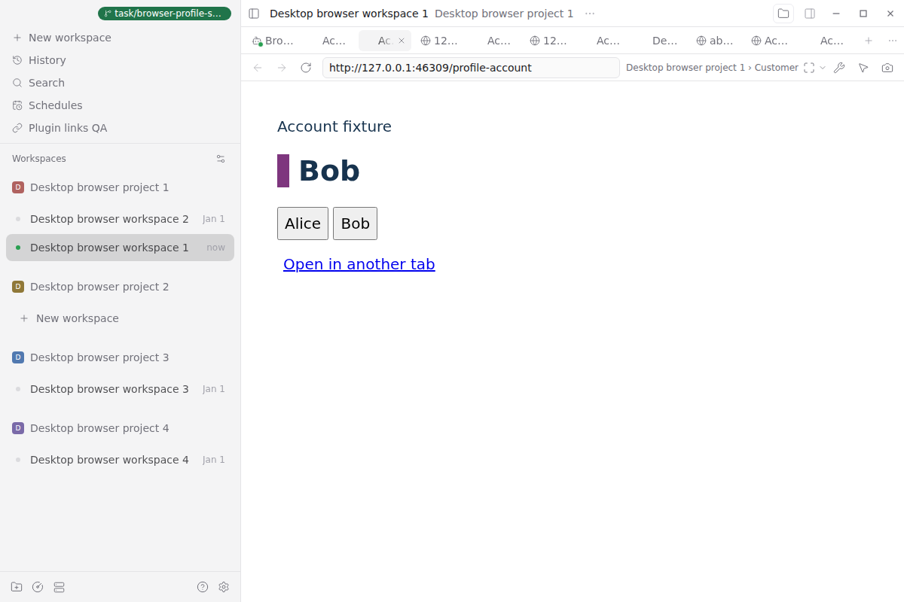
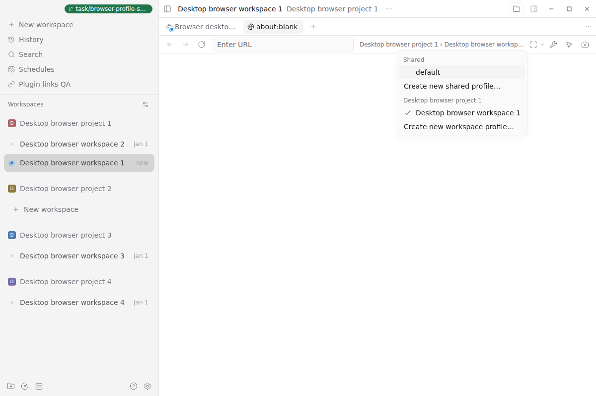
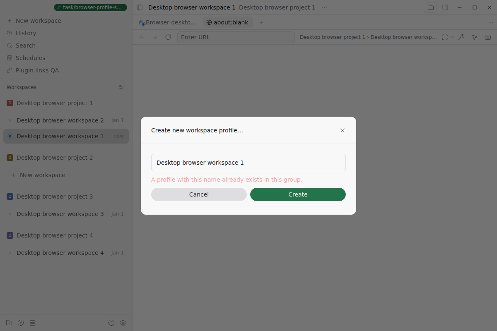
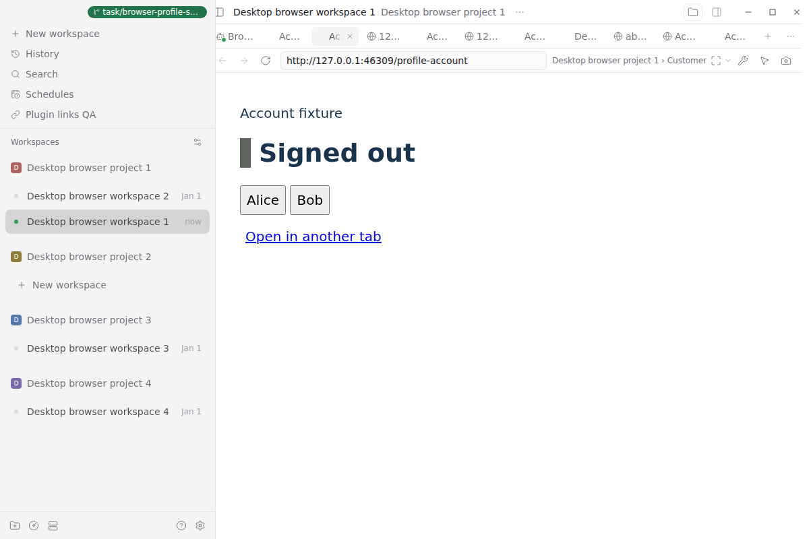

Title: feat(desktop): choose a browser profile per tab, scoped to Shared or the current project

Base: getpaseo/paseo main · Head: clkao:task/browser-profile-selector (91b91456)

---

### Linked issue

Discussion: {LINK: the maintainer's comment proposing a per-tab browser profile selector}. Follows up on #2089.

### Type of change

- [ ] Bug fix
- [x] New feature
- [ ] Enhancement
- [ ] Refactor
- [ ] Docs

### Reasoning

Since #2089 every browser tab in every project shares one Electron session. That keeps sign-ins across tabs and restarts, but it has two costs:
- A user cannot keep two accounts on one site apart, such as a staging admin and a customer test account.
- An agent's browser tools in one project act with the sign-ins of every other project.

This PR adds a profile selector to a new tab, as the maintainer suggested. A tab picks its profile before it loads its first page. After that the profile is fixed, and the toolbar shows it as a read-only label. Existing sign-ins stay where they are, under **Shared › default**.

### Goals

- **Selector.** A blank tab offers **Shared** profiles and the **current project's** profiles, plus one automatic profile for the current workspace. Each group has a "Create new…" action.
- **Defaults.** New tabs open in the current workspace's profile. That covers user tabs, ordinary links that open a new tab, plugin links and agent `browser_new_tab`. Popups keep their opener's session.
- **Fixed after first load.** Once the first page loads, the profile cannot change, including after a return to `about:blank` or a restart.
- **Scope in the session name.** Session names carry their scope in the prefix (`persist:paseo-shared-…`, `persist:paseo-project-<hashed server+project id>-…`). Renaming a project moves no data, and equal project names on different servers stay apart. The webview attach check accepts only these forms and the existing `persist:paseo-browser`.
- **Clearing.** Clear browser data signs every profile out, closed ones included, and keeps profile names and each tab's choice.

### Non-goals

- Choosing a profile from another project (follow-up).
- Changing the profile of a tab that has already loaded a page. Open a new tab instead.
- Plugin APIs that write cookies into a profile.
- Unicode normalization of profile names. `e`+U+0301 and `é` are still treated as two names (follow-up).
- Migrating existing data. `persist:paseo-browser` is reused as Shared › default.

### QA

Run on Linux x86_64, Electron 44.2.0, under Xvfb, with isolated daemons and user data. The production daemon was not touched. The implementation was checked by an independent validation run, whose raw logs are linked below.

**The workflow, across a full Electron restart.** One site, two profiles, two accounts:

| | Before restart | After restart |
|---|---|---|
| Shared › Work (Alice) |  |  |
| Project › Customer (Bob) |  |  |

The selector on a blank tab lists Shared and the current project only:

A name that collides with the workspace's automatic profile is refused:

After Clear browser data, a closed profile reopens signed out and keeps its label:

{RECORDING: a short video of choosing a profile on a blank tab, loading a page, and the label locking. CONTRIBUTING asks for a recording for interactive UI changes.}

**Commands and raw output:**

| Check | Result | Raw output |
|---|---|---|
| Seven Vitest files, one at a time, `--bail=1` | 71 passed | [vitest.txt](https://github.com/clkao/paseo/blob/0c10bc616c548958df655b6c53f70d6697236c94/browser-profile-selector/validation-cycle-2/vitest.txt) |
| Electron capture harness, `browser-profile` group (two processes) | 6/6 | [harness.txt](https://github.com/clkao/paseo/blob/0c10bc616c548958df655b6c53f70d6697236c94/browser-profile-selector/validation-cycle-2/harness.txt) |
| `npm run test:e2e:browser-tabs --workspace=@getpaseo/desktop` (existing regressions, plus a three-launch profile journey) | passed | [journey.txt](https://github.com/clkao/paseo/blob/0c10bc616c548958df655b6c53f70d6697236c94/browser-profile-selector/validation-cycle-2/journey.txt) |
| `npm run typecheck` / `lint` / `format` | passed | [typecheck](https://github.com/clkao/paseo/blob/0c10bc616c548958df655b6c53f70d6697236c94/browser-profile-selector/validation-cycle-2/typecheck.txt) · [lint](https://github.com/clkao/paseo/blob/0c10bc616c548958df655b6c53f70d6697236c94/browser-profile-selector/validation-cycle-2/lint.txt) · [format](https://github.com/clkao/paseo/blob/0c10bc616c548958df655b6c53f70d6697236c94/browser-profile-selector/validation-cycle-2/format.txt) |

**Platforms:**

| Platform | Tested | Notes |
|---|---|---|
| iOS | n/a | Shared app code typechecked; the selector is Electron only |
| Android | n/a | same |
| Web | n/a | same; the browser pane is Electron only |
| Desktop macOS | {FILL} | not yet run |
| Desktop Windows | no | not run |
| Desktop Linux | yes | Electron 44.2.0, Xvfb |

**Size:** 40 files, +1,934 / −213. Production code, translations and docs come to +769 net. Tests are +952 net: 364 unit and browser, 512 full-app journey, 76 capture harness.

### Checklist

- [x] Plugin changes follow the SDK import boundaries (not applicable)
- [x] One focused change
- [x] `npm run typecheck` passes
- [x] `npm run lint` passes
- [x] `npm run format` passes
- [x] QA evidence
- [x] Tests added or updated where it made sense
