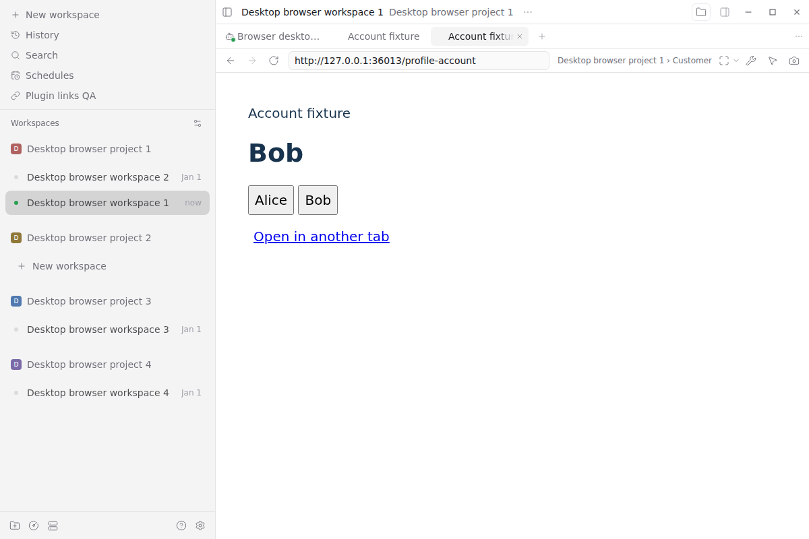
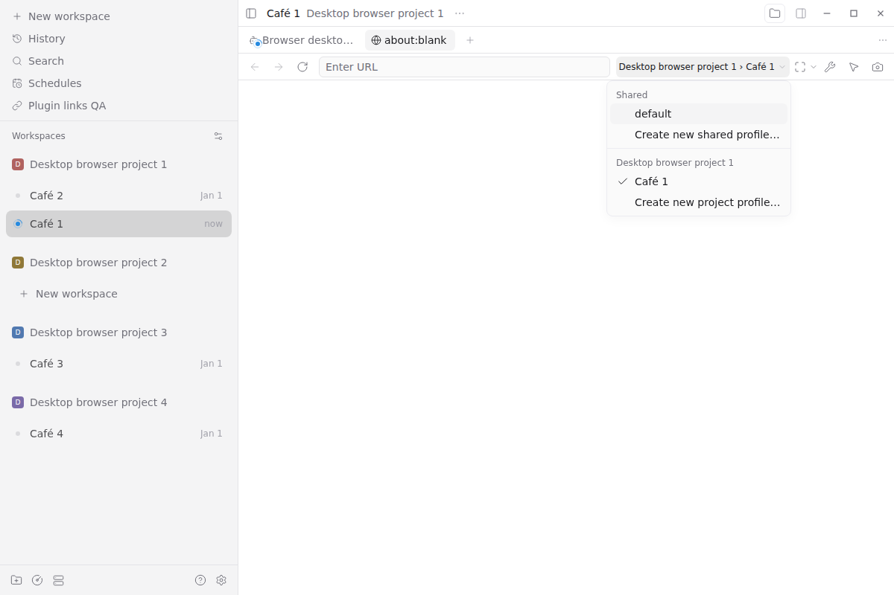
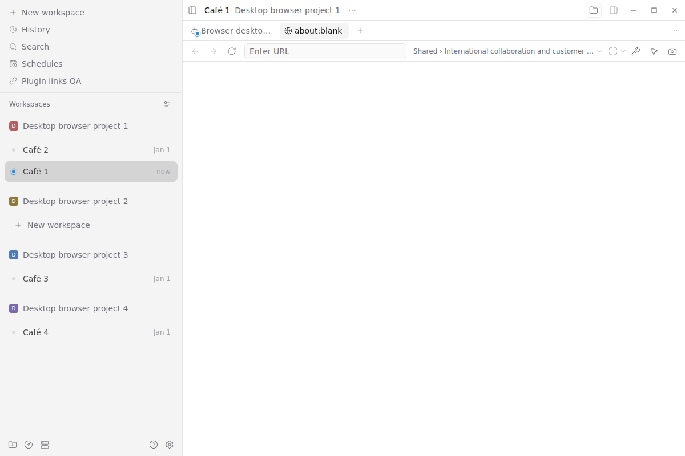
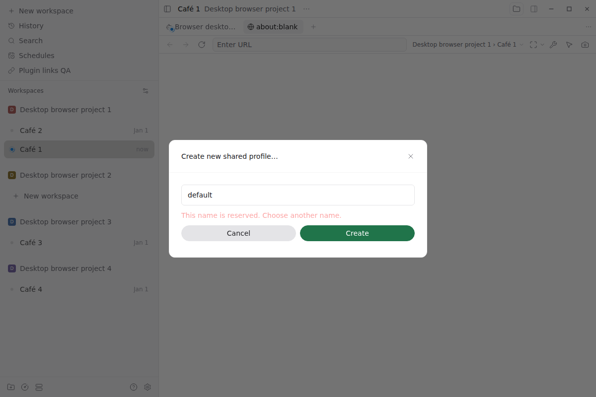
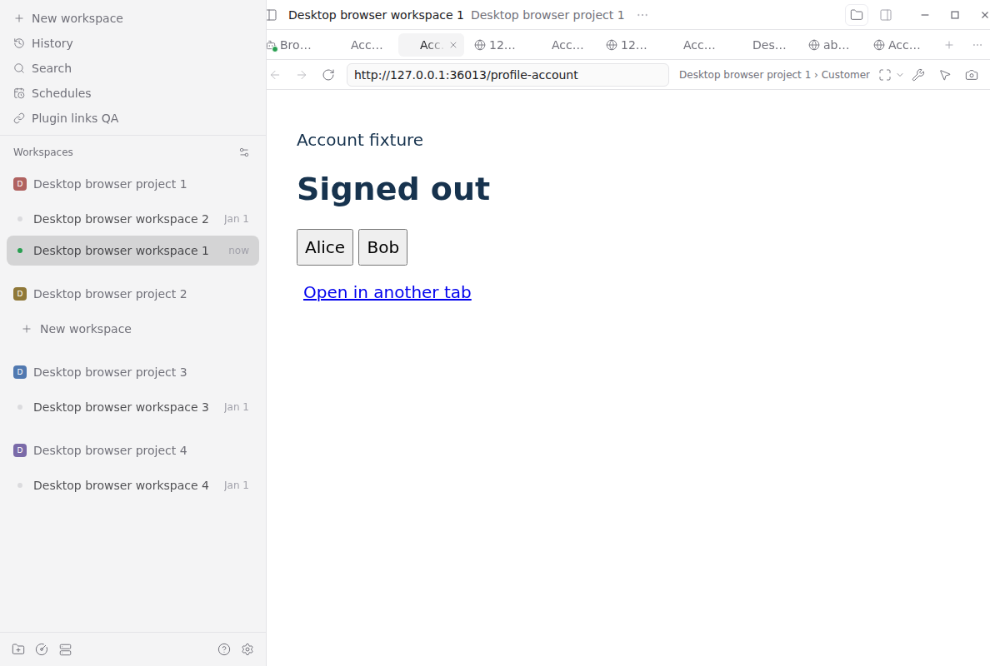

Title: feat(desktop): choose a browser profile per tab, scoped to Shared or the current project

Base: getpaseo/paseo main · Head: clkao:task/browser-profile-selector (1618e78f, on cba515ef)

---

### Linked issue

Discussion: [discord](https://discord.com/channels/1481169421832814616/1571737478581461133). Follows up on #2089.

### Type of change

- [ ] Bug fix
- [x] New feature
- [ ] Enhancement
- [ ] Refactor
- [ ] Docs

### Reasoning

Since #2089 every browser tab in every project shares one Electron session. That keeps sign-ins across tabs and restarts, but it has two costs:
- A user cannot keep two accounts on one site apart, such as a staging admin and a customer test account.
- An agent's browser tools in one project act with the sign-ins of every other project.

This PR adds a profile selector to a new tab, as the maintainer suggested. A tab picks its profile before it loads its first page. After that the profile is fixed, and the toolbar shows it as a read-only label. Existing sign-ins stay where they are, under **Shared › default**.

### Goals

- **Selector.** A blank tab offers **Shared** profiles and the **current project's** profiles, plus one automatic profile for the current workspace. Each group has a "Create new…" action.
- **Defaults.** New tabs open in the current workspace's profile. That covers user tabs, ordinary links that open a new tab, plugin links and agent `browser_new_tab`. Popups keep their opener's session.
- **Fixed after first load.** Once the first page loads, the profile cannot change, including after a return to `about:blank` or a restart. Renaming the workspace does not reattach a live tab.
- **Scope in the session name.** Session names carry their scope in the prefix (`persist:paseo-shared-…`, `persist:paseo-project-<hashed server+project id>-…`). Renaming a project moves no data, and equal project names on different servers stay apart. The webview attach check accepts only these forms and the existing `persist:paseo-browser`.
- **Names.** Profile names are compared in Unicode NFC, so `e`+U+0301 and `é` are one name. A duplicate, a reserved name or a name that collides with the workspace's automatic profile is refused with its own message.
- **Clearing.** Clear browser data signs every profile out, open and closed ones, and keeps profile names and each tab's choice.

### Non-goals

- Choosing a profile from another project (follow-up).
- Changing the profile of a tab that has already loaded a page. Open a new tab instead.
- Plugin APIs that write cookies into a profile.
- Migrating existing data. `persist:paseo-browser` is reused as Shared › default.

### QA

Run on Linux x86_64, Electron 44.2.0, under Xvfb, with isolated daemons, homes, user data and ports. A second agent did an independent validation at `1618e78f`. For each fix it changed the code to break the behavior and saw a committed test fail. [Validation report](https://github.com/clkao/paseo/blob/6e6c9fa821ea73a88000bd6b4106940c3de4b914/browser-profile-selector/validation-cycle-4/REPORT.md)

| Check | Result |
|---|---|
| Unit and browser tests, one file at a time with `--bail=1` | 351 passed in 34 files |
| Electron capture harness, `browser-profile` group (two processes) | 6/6 |
| `npm run test:e2e:browser-tabs --workspace=@getpaseo/desktop`, the existing regressions plus a profile journey across relaunches | passed, cold and warm |
| `npm run lint` / `format:check` / `typecheck` | passed |

**The workflow, across a full Electron relaunch.** One site, two profiles, two accounts:

| | Before relaunch | After relaunch |
|---|---|---|
| Shared › Work (Alice) |  |  |
| Project › Customer (Bob) |  |  |

The selector on a blank tab lists Shared and the current project only:

A long label keeps its chevron:

A reserved name is refused with its own message:

After Clear browser data, a closed profile reopens signed out and keeps its label:

The screenshots come from the validation of `5a0bf144`. The only later commit changes the desktop e2e test.

**Platforms:**

| Platform | Tested | Notes |
|---|---|---|
| iOS | n/a | Shared app code typechecked; the selector is Electron only |
| Android | n/a | same |
| Web | n/a | same; the browser pane is Electron only |
| Desktop macOS | no | not run |
| Desktop Windows | no | not run |
| Desktop Linux | yes | Electron 44.2.0, Xvfb |

**Size:** 44 files, +2,318 / −255. Production code comes to +812 net, translations +126 and docs +2. Tests are +1,123 net, most of it the full-app profile journey and the capture harness.

### Checklist

- [x] Plugin changes follow the SDK import boundaries (not applicable)
- [x] One focused change
- [x] `npm run typecheck` passes
- [x] `npm run lint` passes
- [x] `npm run format` passes
- [x] QA evidence
- [x] Tests added or updated where it made sense
